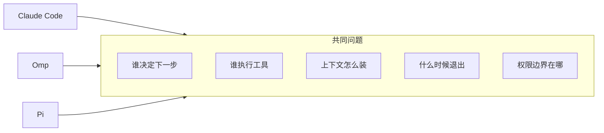

# 第25章 三册对照：同构点与不能借用的数字

三本书，三个对象：Claude Code、Omp、Pi。

它们共享同一个骨架：模型 + 工具 + 循环。但默认值、权限模型、会话格式、扩展接口都不一样。
这一章做两件事：给一张对照表，和一套"怎么比较"的方法。

## 25.1 先钉版本，再比较

本机 2026-11-08 实测：

```console
$ pi --version
1.5.0
$ omp --version
omp/18.18.1
$ claude --version
2.1.319 (Claude Code)
```

三个数字都**不是**三本书的写作钉：本书钉 `pi/1.5.0`；Omp 那册钉 `omp/18.15.0`（本机曾核对 18.16.0）；
Claude Code 是闭源产品，版本随发布变化。比较之前先写清"拿哪个版本比"，否则表格里全是漂移。

## 25.2 对照表（只列结构，不列数字）

| 主题 | 御舆（Claude Code） | Omp | Pi |
| --- | --- | --- | --- |
| 执行循环 | 对话循环 + 工具 | agent 循环 | `agent` 包 + turn |
| 默认工具 | 内置 + MCP + 插件 | 30+ 内置 | 4 个默认 + 平台可选 + 扩展 |
| 权限 | 权限管线（hooks/审批） | 审批 + 沙箱 | **无内置权限系统** |
| 上下文 | 记忆 + 上下文管理 | 记忆系统 | 系统提示 + 上下文文件 + 技能描述 + 压缩 |
| 扩展 | hooks / skills / 插件 | Skills / MCP / 扩展 | 扩展 / 技能 / 模板 / 主题 / 包 |
| 多 agent | 子智能体 / 协调器 | 内置子代理 | **不自带**，靠扩展或外部编排 |
| 编程接口 | SDK | SDK / RPC | SDK / RPC / JSON / print |
| 会话 | 持久化对话 | 自有格式 | JSONL 树（v3） |
| 界面 | TUI | TUI | TUI（独立包） |



## 25.3 哪些可以借，哪些不能

**可以借的**：

- 三分法（模型 / 工具 / 循环）与 turn/run 的区分。
- "活动分支决定上下文"——三家都成立。
- "摘要换窗口、原文仍落盘"——压缩的通用思路。
- "验收标准先写"——交付章节的通用方法。

**不能借的**：

- 工具数量、provider 数量、默认模型、价格。
- 权限默认值：御舆有管线，Pi 没有；把御舆的审批当成 Pi 的行为是错的。
- 会话字段名与文件路径。
- 扩展/技能的目录与 frontmatter 细节。
- 结束信号的名字：Pi 的 `agent_settled` 不是通用词。

## 25.4 本章小实验：做一次"版本对拍"

```bash
pi --version
omp --version
claude --version
```

本机输出如上。把三个数字分别与三册的写作钉对比：

- 与钉一致：可以按书里的数字读。
- 不一致：先看该册附录 E / VERIFY 的漂移处理，再决定哪些结论仍成立。
- 某册没有版本号（闭源产品）：以该册写明的核对日期为准，不假设"最新版一样"。

这一步不需要 API key，也不改任何文件；它是读三本书之前最划算的三十秒。

## 25.5 翻车对照：跨册比较的五个坑

| 翻车做法 | 会看到什么 | 正确做法 |
| --- | --- | --- |
| 把 Omp 的 30+ 工具当成 Pi 的 | 对 Pi 的能力判断过高 | 回 Pi 的 `--help` 与 `DEFAULT_TOOL_NAMES` |
| 把御舆的权限管线当成 Pi 的 | 以为 Pi 会审批 | 读 `docs/security.md`：没有内置权限系统 |
| 用 `omp` 的旗标跑 `pi` | 报未知选项 | 三册命令不通用；各查各的 `--help` |
| 拿"最新版"比较书里的钉版 | 结论对不上 | 先钉版本，再比较 |
| 把名称相近当行为相同 | 细节全错 | 只借问题清单，逐项回文档验证 |

## 25.6 收束

Pi 的价值不在"功能多"，而在**边界清楚**：四个默认工具、没有内置权限系统、扩展与技能按需加载、
会话是一棵公开的树。你读完这本书，应该能做到三件事：

1. 用最小配置跑通一个真实任务，并知道哪里该复核。
2. 需要新能力时，选对扩展点（上下文文件 / 模板 / 技能 / 扩展 / 包），而不是先写代码。
3. 在不可信环境里，先画隔离边界，再谈模型表现。

这也是三册共同的结论：**agent 的能力上限由模型决定，下限由 harness 的边界决定。**

---

**版本核对清单**（写作钉 `pi/1.5.0`，提交 `f9a2636`；本机 2026-11-08 复验）

- [ ] `pi --version` 是否仍是 1.5.0；不是则先看附录 E。
- [ ] Omp 册的写作钉与本机 `omp --version` 是否仍不同；不同不构成错误，但要写清。
- [ ] Claude Code 的版本号是否仍随发布变化；不要把它写成固定值。
- [ ] 25.2 表的每一格是否仍能在对应册的钉版文档中找到依据。
